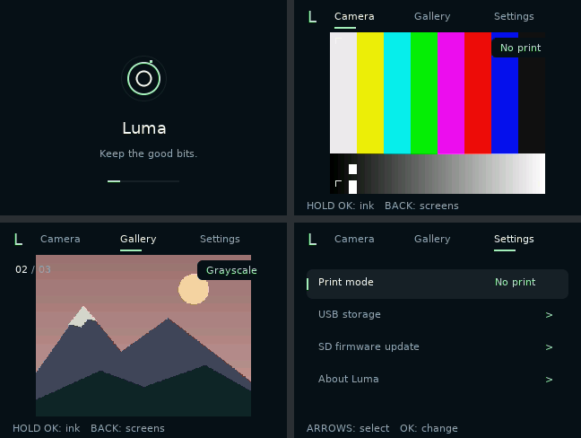
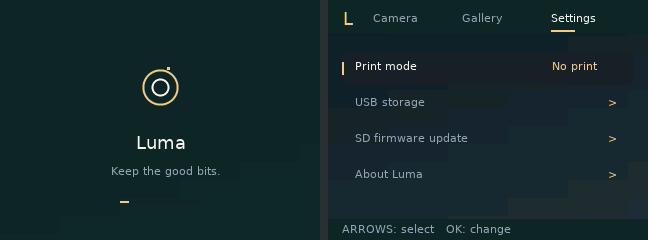

# Luma firmware (RAM development milestone)

Luma is a new freestanding AX3292 application with three screens: camera,
gallery, and list settings. It does not call the stock application or include a
stock firmware dump. The shared core builds for the original KC02, MYSTILUCK
X8D, and HMOLLIMT Z-12 board profiles. The SD command/DMA contract now lives
once, in `src/sd_hw.c`, and is shared with the bring-up stage.

**Do not flash these builds.** They run from RAM in QEMU. They lack cold-boot
bring-up, a USB controller driver, physical printer safety controls, and a
recovery loader. Do not rename `luma.ram.bin` to `DestBin.bin` or `firmware.img`.

A separate [first-stage bring-up](BRINGUP.md) (`bringup/`) now exists for the
original KC02: a recovery gate and GDB-over-USB monitor that runs before any UI.
It is also experimental and not flash-qualified. It preserves the factory boot
chain, serves a checkpoint-only debug monitor, and finds and validates a
stock-format update candidate on the card read-only. It cannot install one: the
gate has no writer and no trusted boot-prefix snapshot to compare against.



The renderer antialiases glyphs, circles, and rounded corners at native
resolution. Shape edges use 4×4 coverage samples, not a larger framebuffer or a
screen-wide blur. Boot rings move in eighth-pixel steps. This adds about 1 KiB
of code and no framebuffer memory. [A 4× nearest-neighbor crop](../docs/images/luma/aa-detail.png)
shows the actual coverage pixels in QEMU.



## Run in QEMU

You need the repository's patched QEMU and reconstructed **little-endian,
no-delay AX3292 compiler**, not an unpatched OpenRISC GCC. See
[toolchain notes](../toolchain/README.md). The build checks ELF endianness,
no-delay flags, and entry address; the linker limits RAM to the smallest board's
2 MiB, including a 16 KiB stack reserve.

From the repository root:

```sh
# Set this if the compiler is not on PATH or in ~/.cache/kc02-toolchain/prefix/.
# export OR1K_TOOL_PREFIX=/path/to/prefix/bin/or1k-elf-
python3 custom-firmware/tools/build.py

# Create a NEW, PRIVATE FAT16 card; do not reuse a mounted/user card.
python3 custom-firmware/tools/card.py ~/.cache/kc02-emulator/luma.img --demo-photos

python3 custom-firmware/tools/run.py --board original \
  --sd-card ~/.cache/kc02-emulator/luma.img
# Close it before reusing the card:
python3 custom-firmware/tools/run.py --board x8d \
  --sd-card ~/.cache/kc02-emulator/luma.img
python3 custom-firmware/tools/run.py --board z12 \
  --sd-card ~/.cache/kc02-emulator/luma.img
```

`run.py` uses SDL by default. `--headless` disables the window. `--qemu PATH`
selects a different build. QEMU locks the card exclusively. `card.py` refuses an
existing path. Starting without `--sd-card` works, but capture reports that it
could not save, and the gallery is empty.

The demo photos are generated landscape illustrations. Camera captures come
from CSI input; QEMU currently supplies its synthetic sensor pattern.

### Controls

| Key / action | Camera | Gallery | Settings |
|---|---|---|---|
| Short Escape / native Back | Gallery | Settings | Camera |
| Previous / next arrows | Print mode | Previous / next photo | Select list row |
| Short Enter / native OK | Capture, then print if enabled | Print selected photo | Activate row |
| Hold OK for 650 ms | Cycle print mode | Cycle print mode | No action |

The print mode is shared between camera and gallery: **No print → Dither →
Grayscale**. It survives screen changes, but not a reboot yet. No print is the
boot default. A long OK does not also trigger a shutter or print.

The X8D's Up/Left and Down/Right buttons share ladder levels. Navigation does
not require distinct vertical and horizontal keys. X8D `F` and Z-12 `P` also
cycle print mode. Z-12 `M` drives the native PE11 front/selfie selection.

The current UI reports **Printer not ready**, **USB storage not ready**, or
**Updater not ready** for those actions. These are release blockers, not
successful operations hidden behind placeholder notifications.

## Theme from the SD card

Put `THEME.INI` in the card's root. You can change five colors and the boot and
shutter durations without rebuilding firmware. Optionally add `BOOT.BMP` and
`BACK.BMP` alongside it:

```ini
background = #0c1218
panel = #1a232c
text = #f1f4ed
muted = #96a7b2
accent = #a4edbf
boot_ms = 1300
shutter_ms = 300
boot_image = BOOT.BMP
background_image = BACK.BMP
```

Use **320×240 uncompressed 24-bit BMPs**, exported by an image editor. Names must
be uppercase 8.3 filenames. The firmware fades the boot image in beneath the
animated lens mark and uses the background image on the settings screen. HUD
rails remain opaque so labels stay readable. Restart to load changes; hot
reload is not implemented.

Omit the two image keys to use the built-in artwork. An invalid config rejects
the entire file and keeps the default palette. A missing or invalid image
falls back to the built-in background. The parser limits the config to 4 KiB,
lines to 127 bytes, boot duration to 300–3000 ms, and shutter duration to
100–600 ms. Unknown keys reject the config. No paths, scripts, fonts, or
executable code load from the theme.

For a private development image, prepare a theme directory on the host:

```sh
python3 custom-firmware/tools/card.py /new/path/my-luma.img --theme ./my-theme
```

The current filesystem supports partitioned/superfloppy FAT16 with two matching
FATs, 512-byte sectors, short root filenames, and SDHC cards. FAT32, long names,
subdirectories and SDXC/exFAT remain unsupported. Capture saves 320×240 BMPs as
`LUM00001.BMP`, etc.; gallery handles these files only, not stock JPEGs. It stops
at 64 photos. Delete/move photos on the host while QEMU is **closed** to reclaim
space. It does not overwrite, delete, or format files itself.

Data writes precede allocation updates and directory publication. On a write
failure, the firmware makes the current mount read-only. Interrupted writes can
leave orphan clusters; FAT16 is not power-loss atomic. Do not use valuable media
for development.

## Tests

```sh
python3 -m pytest -q tests/test_custom_firmware.py
python3 custom-firmware/tools/build.py
python3 custom-firmware/tools/smoke.py \
  --output ~/.cache/kc02-emulator/luma-run-NEW
```

The smoke test creates three private cards, drives QEMU's native ADC keys,
observes guest state read-only, and tests boot, CSI motion, capture, all print
modes, gallery, list navigation, and persistence across cold boots. It also tests
Z-12's PE11 sensor selection. It inspects FAT contents only after QEMU exits.
It refuses an existing evidence directory. Add `--theme DIR` to test SD artwork.

Milestone verification: **181 tests passed, 5 skipped, 51 subtests**, including
42 new native-core tests. The all-board QEMU smoke and an additional SD-image
theme smoke passed. The native tests compile the actual C core with
undefined-behavior checks. They cover malformed themes/BMPs, bounded rendering,
antialiased shape symmetry and clipping, keypad debounce/hold handling,
FAT publication/failure/ownership, RSP protocol, and transactional update policy.
Where available, a real `gdb-multiarch` client tests RSP through a **host test
harness**. That test does not connect to a camera or exercise USB.

`run.py --gdb 1234` exposes QEMU's existing localhost debugger. This is separate
from the new RSP engine and is **not USB hardware debugging**; QEMU's existing
register-endianness limitation still applies. See [emulator GDB notes](../tools/emu/README.md).

## Required before a hardware release

| Requirement | Current evidence | Remaining work |
|---|---|---|
| Three screens and animations | Guest code running on all three QEMU board profiles | Physical display/input validation |
| SD themes and persistent capture/gallery | FAT16 guest and native tests | FAT32, JPEG, removal/full-card recovery, physical SD driver |
| Dither / grayscale / no print | Shared UI policy and 384-dot raster tests | Head driver, temperature/supply/paper interlocks and measured energy limits |
| GDB attached over USB | RSP engine, 35 little-endian registers, actual GDB client test | USB controller, bridge, stop/resume exception context, cache coherence, breakpoints, no-delay stepping |
| USB mass storage | Exclusive ownership primitive | Composite descriptors, BOT/SCSI, controller driver and host tests |
| WebUSB flashing | Shared image/update engine in NOR tests | Vendor interface/BOS/Windows binding, staging protocol, browser client, physical confirmation and real recovery |
| `/firmware.img` SD update | Shared image/update engine in NOR tests | File discovery/staging adapter, recovery loader, NOR driver, real interrupted-update tests |
| Stock-compatible first installation | Offline `DestBin` candidate packer and read-only candidate validation | SD recovery reader, NOR writer, external SPI recovery proof, real stock-updater test with an unchanged image |
| Boots on actual boards | Compiler validated earlier; application tested only in QEMU | Clock/SDRAM, pinmux, panel and sensor initialization, protected recovery installation |

See [architecture and service contracts](DESIGN.md) for the USB/debug/update
boundaries. None of the USB, update, physical-printing, or flash-installation
requirements is complete. They remain part of the requested firmware, not
optional follow-ups.
